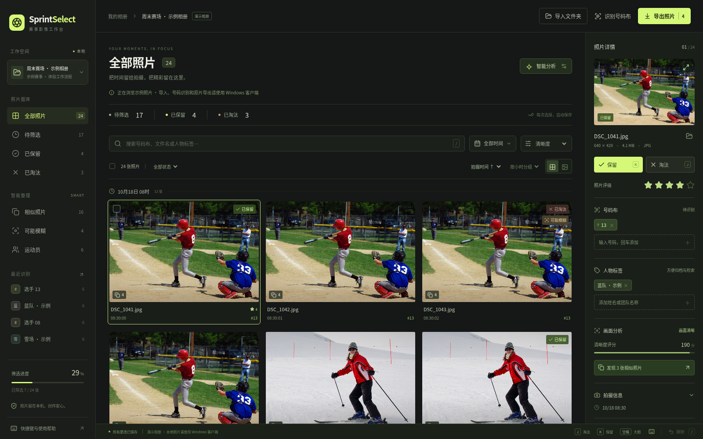

# SprintSelect · 赛事选片

面向 Windows 10/11 x64 的本地照片筛选工具。参考视频里「逐张保留/淘汰 → 相似照片对比 → 统一处理」的操作流程，加入赛事摄影需要的号码检索与批量归档。



## 开始使用

Windows 用户请在 [GitHub Releases](https://github.com/zocoruy/123213/releases) 的 Assets 中下载 `SprintSelect-0.1.0-Portable-x64.exe`。本地构建文件也会保存在 `release/`。首次运行选择照片文件夹，子目录会一并读取；初次建立缩略图需要一些时间，之后重新导入相同目录会复用缓存和筛选记录。

1. **先粗筛**：用「可能模糊」查看需要复核的照片，用「相似照片」并排比较连拍。
2. **快速选片**：进入「待筛选」，`K` 或右方向键保留，`J` 或左方向键淘汰，`U` 跳过，`Z` 撤销，空格查看大图。`A/D` 或上下方向键切换照片，`1–5` 评星。
3. **找运动员**：点击「识别号码布」，或勾选一批照片只识别这些照片；搜索号码、文件名、姓名/队伍标签。右侧可修改号码和人物标签，勾选后可批量设置。人物分组来自标签，不含自动人脸识别。
4. **按时间查找**：按小时/日期分组，或设置拍摄时间范围。优先使用 EXIF 拍摄时间，没有 EXIF 时使用文件修改时间。
5. **交付**：导出所有已保留照片，或仅导出手工勾选的照片；可按人物/号码、拍摄日期创建子目录，同时生成 CSV 清单。

「淘汰」只保存一个标记。应用不删除、不移动、不改写原片；导出使用复制，并且不会覆盖同名文件。请对确实需要删除的原片使用你自己的文件管理流程。

## 支持范围

- 照片：JPEG、PNG、WebP、TIFF、AVIF。RAW（CR2/CR3/NEF/ARW/DNG 等）需先转换。当前不处理视频。
- 数字号码 OCR：随安装包提供本地模型，无需账号或上传照片；当前识别 2–6 位数字，保留前导零。单数字队服号码、字母前缀暂不自动识别，可手工录入。
- OCR、模糊和相似度均为辅助建议。遮挡、倾斜、运动拖影和复杂背景可能导致遗漏或误识别，请人工复核；不自动淘汰照片。
- 「人物标签」支持姓名和队伍等自定义分组，**没有自动识别人脸**。
- 清晰度阈值和相似度阈值可调整；相似分组按图像结构判断，不代表同一运动员。时间采用本机时区显示，无时区的相机 EXIF 依照本机时区解释。
- 默认恢复最近打开的相册；重新导入以前的文件夹可以恢复该场赛事的筛选记录。源照片移动或重命名后需要重新导入，对应路径会视为新照片。
- 不提供云同步、地图足迹、拍摄相机或照片编辑功能。

## 数据保存在什么地方

Windows 的照片库、筛选结果与缩略图位于 `%APPDATA%\sprintselect\library`。`album.json` 为当前相册，`albums` 为各目录的历史记录，`photo-cache` 为可重新生成的缩略图和预览图。备份筛选结果时保留 JSON 文件；原片仍需自行备份。

界面使用不超过 1800 像素的预览，导出会复制完整原片。处理过程支持取消；重新导入时复用已完成的缩略图。长批次号码识别每完成 10 张保存一次，正常结束或取消时保存最后一批。

## 开发

要求 Node.js 24、npm；桌面调试需要本地图形桌面。

```sh
npm ci
npm run dev:desktop
```

浏览器演示可运行 `npm run dev`，只使用附带的示例相册；导入文件夹、真实 OCR 和原片导出需要桌面客户端。演示照片上的号码、标签、清晰度等元数据是交互示例，不是识别结果。

```sh
npm test                 # 图像、持久化、导出、真实本地 OCR 测试
npm run test:e2e         # 界面交互测试，需要 Playwright Chromium 或系统 Chromium
npm run build           # 类型检查及桌面/界面构建
npm start               # 运行构建后的桌面应用
```

Windows 打包请阅读 [Windows 构建说明](docs/WINDOWS.md)。Windows PowerShell：

```powershell
.\scripts\build-windows.ps1
```

生成安装版、免安装版和 SHA256 校验文件。仓库内提供 GitHub Actions Windows 构建工作流；推送 `v*` 标签会在 Windows runner 中测试和构建，成功后将安装文件附到同仓库的 Release 页面。手动构建或 PR 检查仅生成 Actions 构建附件。

## 当前验证

真实图像测试覆盖 EXIF 旋转/时间、模糊度、相似组、损坏文件、取消续导、独立赛事历史、复制导出和本地号码 OCR。界面流程与批量导入另行运行验证，见 [验证记录](docs/VALIDATION.md)。Windows 实机兼容性仍需在用户机器验证。

可选批量基准：先构建，再运行 `node scripts/benchmark.cjs 2100`。它将三张附带小尺寸样本重复复制为 2100 个文件，实际建立缓存并测试续导，最后自动清理临时目录；不读取个人照片。结果不能用于推算全分辨率相机照片或 RAW 的速度。

## 示例素材

示例相册只用于浏览器界面演示。素材来源与链接见 [示例素材说明](docs/DEMO-ASSETS.md)。
